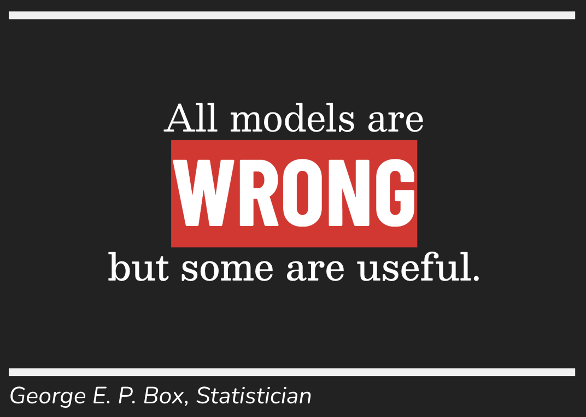
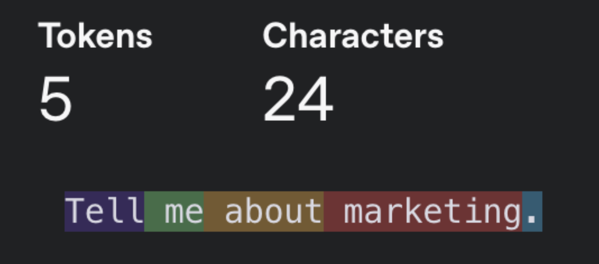
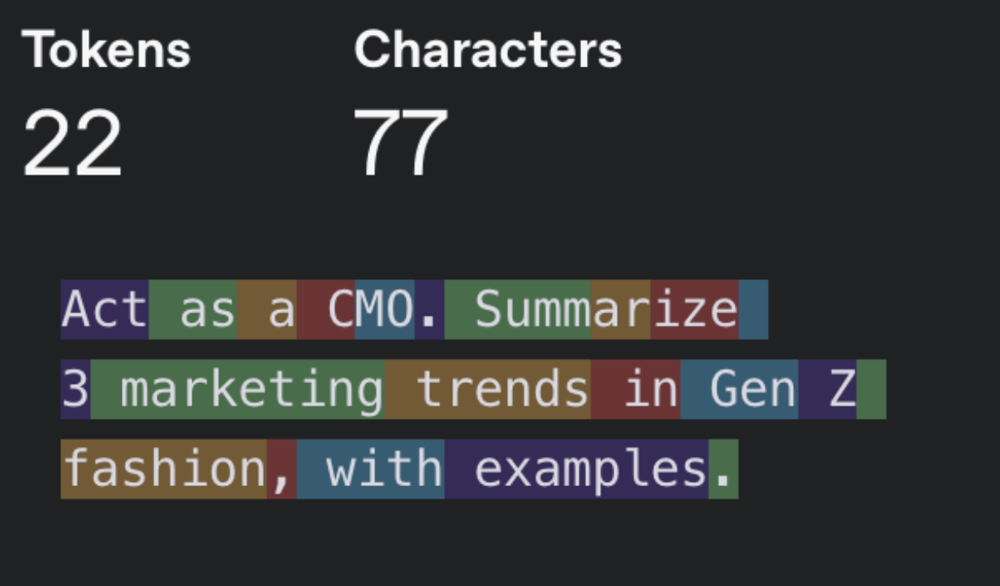

<h1>
  AI Enabled Fundamentals
  LLM Fundamentals & Responsible AI Use in Data
</h1>

**Learning objective:** By the end of this microlesson, you’ll be able to explain how large language models (LLMs) work, write effective prompts for data tasks, and apply critical thinking to evaluate AI-generated outputs.

---

Welcome to your last microlesson of this hour! Here, we’ll demystify *how* large language models (LLMs) like ChatGPT work, how to use them wisely for data tasks, and what it really means to be a responsible “human in the loop.”

---

### What’s an LLM—and How Does It Actually Work?

> 💡 **In Plain English:**  
> An LLM (Large Language Model) is a type of statisitcal model trained on *huge* amounts of text. It predicts the next word, code, or phrase—one step at a time—based on your prompt.

- **LLMs don’t “think” or “understand” like humans.**  
  They generate responses by finding patterns in data, not by reasoning or knowing.
- **Outputs are *fluent* but not always *correct*.**  
  The answer may *sound* confident—even when it’s making things up.

**Example:**
- You prompt: “Write a SQL query to find all orders over $1000 from this table.”
- The LLM might generate perfectly formatted code—but you must check if it’s actually right for your schema.

> 📚 **Term:**  
> *Hallucination* — When an LLM produces information that sounds real, but isn’t accurate.

---

### Prompting - What and Why?

As you probably know, a prompt is the message you send to an LLM for it to respond to:

#### Less Effective Prompt

#### More Effective Prompt

> This prompt gives more structure and signal to the model. 

### Remember: LLMs are Statistical Models...

What you want might NOT be the most likely output. *A good prompt changes the math.*

---

### LLMs in Data: Superpowers and Weaknesses

**LLMs Can:**
- Generate summaries of data, reports, or emails
- Draft code (Python, SQL, etc.) for data analysis
- Help brainstorm or explain findings in plain language

**LLMs Can’t (or Shouldn’t):**
- Access live databases or sensitive internal systems directly (unless integrated carefully)
- Guarantee accuracy, especially with complex, niche, or business-critical queries
- Replace your expertise or business context

> 🚨 **Watch Out:**  
> It’s easy to “fall asleep at the wheel” by rusting an AI’s output without checking. The *better* the model sounds, the more tempting it is to stop double-checking!

---

## Responsible Use: Humans in the Loop

### **Critical Thinking Checklist:**
- Do I understand the *source* of this output? (Does the model know my business logic or dataset details?)
- Did I check the result for errors, bias, or “hallucinations”?
- Would I be comfortable sharing this with a team or client *as is*?

**Scenario:**  
> Your LLM-generated summary says, “Sales increased 20% in Q2 due to a new product launch.”  
> - What would you double-check before sending this to your manager?
> - How would you verify the claim with your own analysis?

---

### Key Takeaways

> 🎯 **Always verify before you trust.**  
> LLMs are amazing assistants, but *you* are the decision-maker. The best data pros use AI as a partner, not a replacement.
